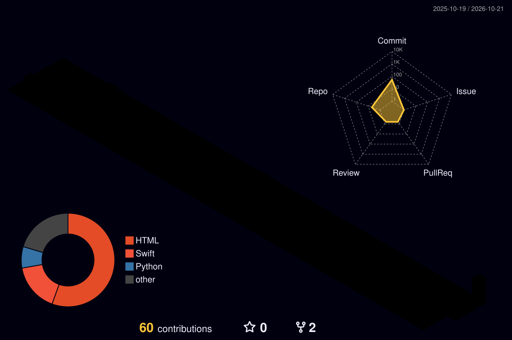

<!-- Banner -->

  

<!-- Typing animation -->

  

<!-- Visitor counter -->

  

  
  
  
  

---

### 🚀 About me

I'm a final-year **B.Tech CSE** student at Lovely Professional University and an **iOS Developer** who ships production apps end to end — from scalable MVVM data models to real-time chat, authentication and App Store release.

- 🔭 Currently building & maintaining App Store apps **@ Krescent IT Labs**
- 📱 Shipped **Yaari** — a real-time social app — at Kunatic
- ⚡ I like clean architecture, fast async flows, and shipping things people actually use
- 🧩 **200+** problems solved on LeetCode
- 🤖 Daily driver: **Claude Code + MCP** for code generation, debugging & refactoring

---

### 🛠️ Tech Stack

**Patterns & Practices:** MVVM · Clean Architecture · async/await · Core Data · Swift Package Manager · Git Flow · CI/CD

---

### 📌 Featured Projects

| Project | Description | Stack | Link |
| :--- | :--- | :--- | :--- |
| **Yaari** | Real-time social app — chat, events, bookings & restaurant matching | SwiftUI · Firebase · MVVM | [App Store ↗](https://apps.apple.com/in/app/yaari/id6762041467) |
| **LPU Live** | Role-based campus communication platform with RBAC admin dashboard | SwiftUI · Firestore · Firebase Auth | [GitHub ↗](https://github.com/hritu1701/LPU-Live) |
| **LinkLit** | Dual-content reader for web articles & PDFs, offline-first | SwiftUI · PDFKit · WebKit | [GitHub ↗](https://github.com/hritu1701/LinkLit) |

---

### 🧊 My Contributions in 3D

  

---

### 📊 GitHub Stats

  
  

  

---

  <i>📍 Phagwara, Punjab, India</i> 
  <b>Let's build something →</b> <a href="mailto:hritu.iosdev@gmail.com">hritu.iosdev@gmail.com</a>

